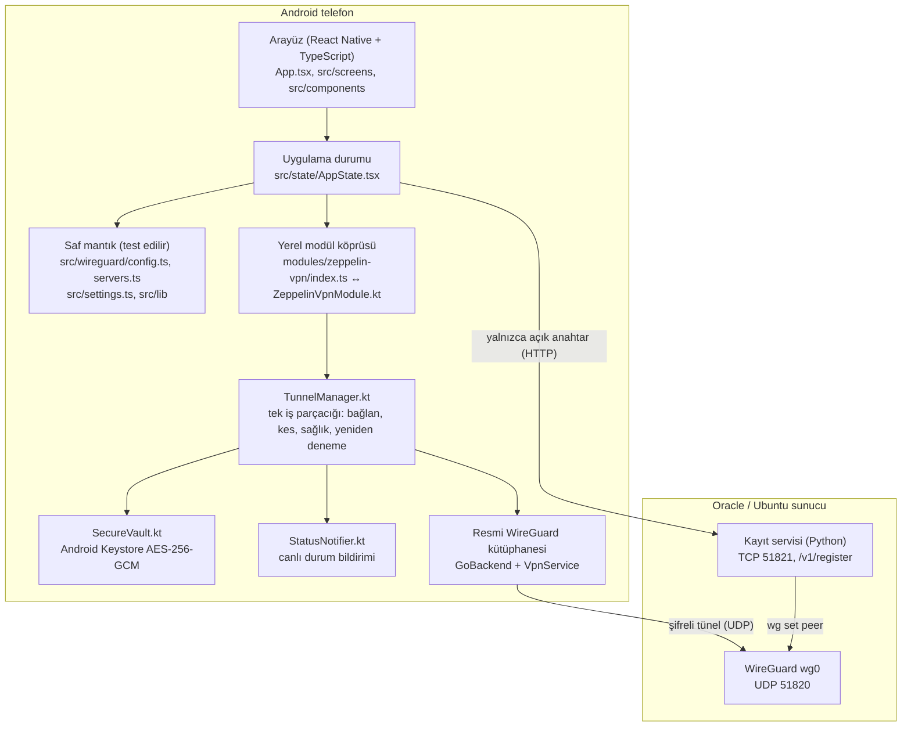
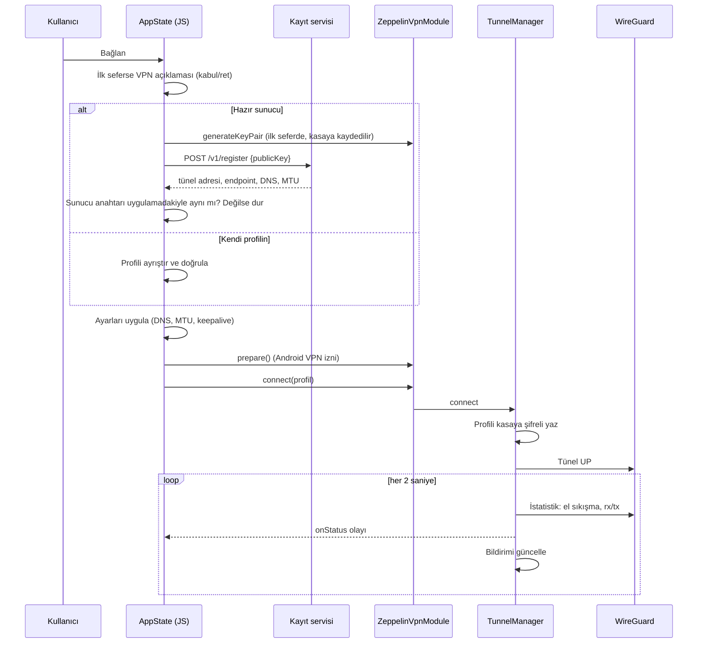
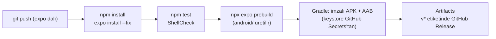

# Zeppelin VPN Mimarisi

Bu belge uygulamanın nasıl kurulduğunu anlatır: katmanlar, dosyalar, bağlanma akışı, hazır sunucu kaydı, güvenlik kararları ve derleme hattı. Kod değiştirmeden önce buradan başla.

## Genel bakış

Üç parça var:

1. **Arayüz ve mantık (TypeScript):** ekranlar, ayarlar, profil ayrıştırma, hazır sunucu kaydı. Saf mantık dosyaları React'e bağımlı değildir, Node testleriyle doğrudan sınanır.
2. **Yerel modül (Kotlin):** `modules/zeppelin-vpn`. Tüneli açar, sağlığını izler, anahtarları şifreli saklar, bildirimi günceller. Bütün VPN işi buradadır; JavaScript yalnızca komut verir ve durumu dinler.
3. **Sunucu (Bash + Python):** `server/zeppelin-oracle-setup.sh`. WireGuard'ı kurar, güvenlik duvarını açar, istenirse hazır sunucu kayıt servisini başlatır.

## Dosyalar

| Yol | Görev |
|---|---|
| `App.tsx`, `index.ts` | Giriş noktası, sekmeler, VPN açıklama penceresi |
| `src/screens/` | Ana ekran, Profiller (hazır sunucular + kendi profillerin), Sunucu rehberi, Ayarlar |
| `src/components/` | Bağlan düğmesi, sekme çubuğu, profil düzenleyici, VPN açıklaması, ortak arayüz parçaları |
| `src/state/AppState.tsx` | Tek durum kaynağı: profiller, seçim, ayarlar, tünel durumu, hız hesabı, çıkış IP kontrolü, bildirim izni |
| `src/wireguard/config.ts` | WireGuard profil ayrıştırıcı/yazıcı, satır numaralı hatalar, ayar uygulamaları (DNS, MTU, keepalive), anahtar gizleme |
| `src/wireguard/servers.ts` | Hazır sunucu yanıtından profil üretimi, hata kodları |
| `src/content/servers.ts` | Hazır sunucu listesi (ad, ülke, kayıt adresi, sabitlenmiş sunucu anahtarı) |
| `src/content/guide.ts`, `privacy.ts` | Uygulama içi Oracle rehberi ve gizlilik politikası |
| `src/settings.ts` | Ayar türleri, varsayılanlar, doğrulama |
| `src/i18n/strings.ts` | Türkçe ve İngilizce metinler |
| `src/generated/serverScript.ts` | Sunucu betiğinin gzip+base64+sha256 ile gömülü kopyası (`npm run embed-server-script` üretir) |
| `modules/zeppelin-vpn/index.ts` | Kotlin modülünün TypeScript tanımı |
| `.../ZeppelinVpnModule.kt` | JavaScript köprüsü: izinler, bağlan/kes, kasa, dosya seçici, pano, bildirim izni |
| `.../TunnelManager.kt` | Tünelin sahibi; tüm durum değişiklikleri tek bir arka plan iş parçacığında sırayla çalışır |
| `.../SecureVault.kt` | Keystore'daki AES-256-GCM anahtarıyla şifreli dosyalar (`noBackupFilesDir`) |
| `.../StatusNotifier.kt`, `NotificationActionReceiver.kt` | Canlı durum bildirimi ve "Bağlantıyı kes" düğmesi |
| `.../BootReceiver.kt`, `ZeppelinApplicationLifecycleListener.kt` | Telefon açılışı / güncelleme sonrası ve Android "Her zaman açık VPN" başlangıcı |
| `plugins/withZeppelinAndroid.js` | Expo config plugin: minSdk 26, ARM mimarileri, Gradle belleği, kayıt servisi için HTTP izni |
| `server/zeppelin-oracle-setup.sh` | Sunucu kurulumu ve `add/show/list/remove/status/repair/public-on/public-info/public-off` komutları |
| `tests/` | Ayrıştırıcı, ayarlar, çeviriler, hazır sunucu, kayıt servisi ve sunucu betiğinin sahte komutlarla uçtan uca testi |
| `.github/workflows/android.yml` | Testler, ShellCheck, `expo prebuild`, imzalı APK + AAB |

`android/` ve `ios/` klasörleri depoda **yoktur**, bu bilerek yapıldı. Expo bunları `app.json` ve config plugin'den her derlemede `npx expo prebuild` ile üretir (Continuous Native Generation). Yerel kodun tamamı `modules/zeppelin-vpn/android` içindedir ve depodadır.

## Bağlanma akışı

**"Bağlı" yalnızca gerçek bir WireGuard el sıkışmasından sonra gösterilir.** Tünelin açılması yetmez.

## Durumlar ve kill switch

| Durum | Anlamı |
|---|---|
| `connecting` | Tünel açık, ilk el sıkışma bekleniyor (15 sn süre tanınır) |
| `connected` | Son el sıkışma taze (180 sn içinde) ya da trafik akıyor |
| `reconnecting` | Sunucu yanıt vermiyor. Tünel açık kalır, trafik dışarı sızmaz (kill switch) |
| `no_network` | Wi-Fi/mobil veri yok; ağ gelince devam eder |
| `error` | Başlatılamadı ya da VPN izni geri alındı |
| `disconnected` | Kapalı |

Kill switch, tüneli açık tutarak çalışır: Android tünel açıkken tüm trafiği tünele yönlendirir, sunucu yanıt vermezse trafik durur. Elle kesince tünel kapanır ve internet hemen döner. Kill switch kapalıysa 30 saniye sonra tünel kapatılır. Tam koruma (açılış, güncelleme) için Android'in "Her zaman açık VPN" özelliği önerilir.

## Hazır sunucu tasarımı

- Telefon kendi anahtar çiftini üretir. **Gizli anahtar telefondan çıkmaz**, sunucuya yalnızca açık anahtar gider.
- Sunucunun açık anahtarı `src/content/servers.ts` içinde sabitlenmiştir. Kayıt HTTP ile gitse de araya giren biri telefonu kendi sunucusuna yönlendiremez: anahtar tutmazsa uygulama bağlanmaz.
- Havuz `10.67.0.0/16`, en fazla 150 cihaz, IP başına saatte 10 kayıt. 14 gün kullanılmayan kayıtlar silinir.
- Sunucu kayıtları yalnızca gün olarak tutar (saat yok). İstek günlüğü yoktur. `public-on`, sistem günlüklerini yalnızca bellekte tutar (en fazla 1 gün).
- Yeni ülke eklemek için o ülkede bir sunucu kurulur, `public-on "Şehir" ÜLKE` çalıştırılır ve basılan satır `src/content/servers.ts` listesine eklenir.

## Güvenlik kararları

- Profiller ve anahtarlar Keystore anahtarıyla şifrelidir. Düz metin yedeği yoktur. `allowBackup=false`.
- Reklam, analiz, çökme raporlama kütüphanesi yoktur. Hesap yoktur.
- Bildirim kilit ekranında ayrıntı göstermez.
- VPN motoru resmi WireGuard kütüphanesidir (Maven Central). Depoda kaynağı belirsiz ikili dosya yoktur.
- İmzalama anahtarı (keystore) ve şifreleri depoda **değildir**. GitHub Secrets'ta durur, `.gitignore` ile dışarıda tutulur.

## Derleme hattı

Sürümler: Expo SDK 58, React Native 0.88, React 19, TypeScript. Android minimum 8.0 (API 26). ARM mimarileri: `armeabi-v7a`, `arm64-v8a`. JDK 17.
